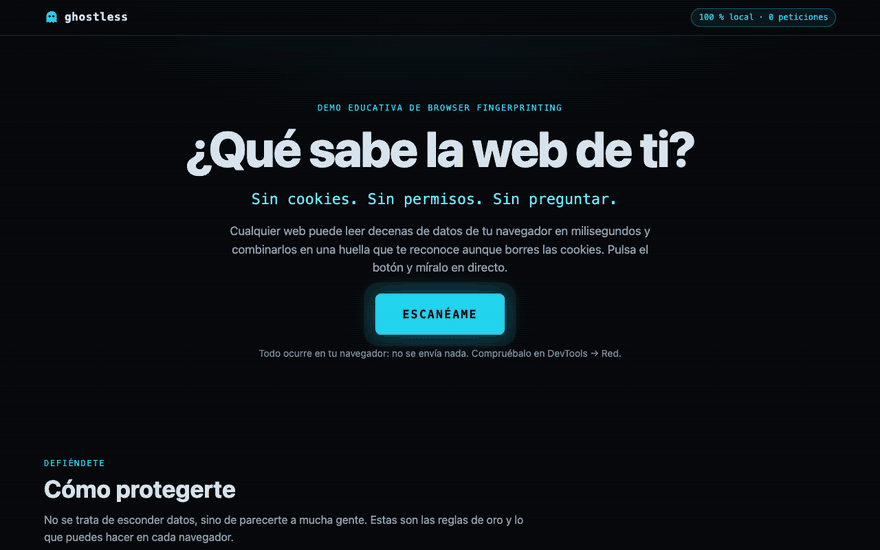
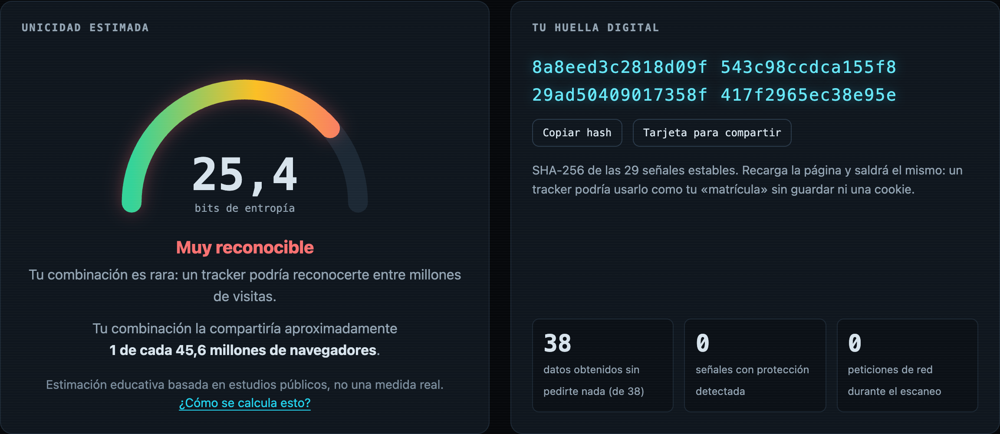
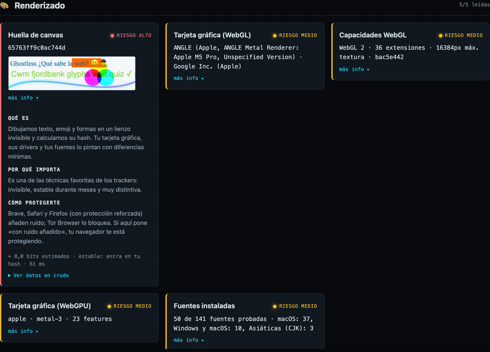
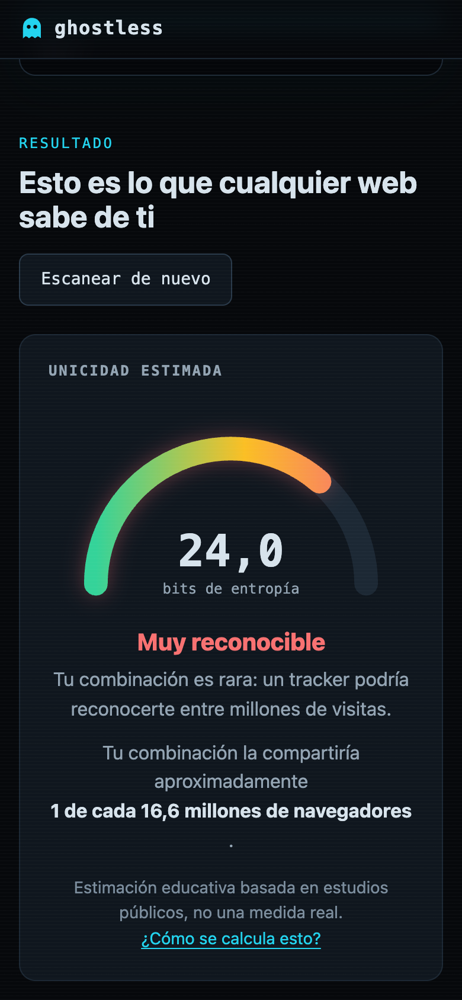
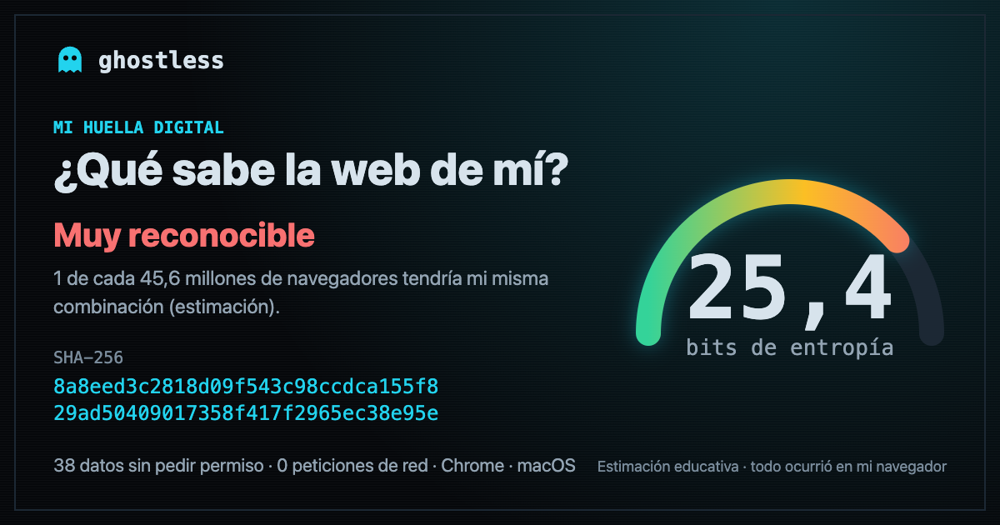

<p align="center">
  
</p>

<h1 align="center">Ghostless</h1>

<p align="center">
  <strong>¿Qué sabe la web de ti?</strong><br>
  Sin cookies. Sin permisos. Sin preguntar.
</p>

<p align="center">
  <a href="https://viiktor08.github.io/Ghostless/"><strong>👻 Pruébalo en tu navegador →</strong></a>
</p>

<p align="center">
  
</p>

Ghostless muestra **en vivo todo lo que cualquier web puede leer de tu navegador sin pedirte permiso**: 38 señales,
desde el modelo de tu tarjeta gráfica hasta las voces de síntesis que tienes instaladas. Las combina en una huella
digital, estima lo fácil que es reconocerte y explica, señal a señal, para qué la usan los trackers y cómo defenderte.

Todo ocurre en tu navegador: **no hay servidor, ni analítica, ni dependencias, y la página no hace ni una sola
petición de red**. Una política de seguridad estricta se lo prohíbe y lo puedes comprobar tú mismo.

## Por qué importa

Las cookies se pueden borrar. Tu navegador, en cambio, cuenta muchas cosas sin que nadie lo pida: pantalla, idiomas,
zona horaria, fuentes, cómo dibuja tu GPU un texto, cómo procesa el audio tu sistema… Por separado parecen inofensivas;
juntas forman una **huella digital** que suele ser única y que sobrevive al modo incógnito y al borrado de cookies.
Es el *browser fingerprinting*, y lo usan desde redes publicitarias hasta sistemas antifraude.

Ghostless hace exactamente lo mismo que un script de fingerprinting real, pero a la vista y para enseñarlo.

## Qué hace

- **Escaneo animado** enlazado a los collectors reales: cada línea aparece cuando termina su señal.
- **Huella SHA-256** de las señales estables (la «matrícula» que un tracker usaría) y **unicidad estimada** en bits.
- **Tarjetas educativas** por categoría: valor leído, nivel de riesgo, qué es, por qué importa y cómo protegerte.
- **Detector de mentiras**: cruza señales entre sí y detecta incoherencias (User-Agent falseado, GPU o fuentes de otro
  sistema…), protecciones anti-fingerprinting (canvas o audio con ruido, GPU enmascarada, reloj degradado) y navegadores
  automatizados.
- **Test de estabilidad** opcional: recuerda tu hash y te dice si cambia entre visitas y qué señal lo ha cambiado.
- **Modo comparar**: exporta tu huella a JSON, ábrela en otro navegador y mira qué te delata aunque cambies de navegador.
- **Tarjeta para compartir** en PNG (solo el hash y la puntuación, nunca tus datos) con descarga y compartir nativo.
- **Cómo protegerte**: reglas de oro y consejos concretos para Chrome, Edge, Firefox, Safari, Brave y Tor Browser.
- Y un secreto para curiosos. 👻

<p align="center">
  
</p>

<table>
  <tr>
    <td width="62%"></td>
    <td width="38%"></td>
  </tr>
  <tr>
    <td colspan="2"></td>
  </tr>
</table>

## Señales recogidas

| Categoría | Señales |
|---|---|
| 🖥️ Navegador y sistema | User-Agent, Client Hints, plataforma, núcleos de CPU, memoria RAM, pantalla táctil, idiomas, cookies/DNT/GPC, visor de PDF, automatización (`navigator.webdriver`) |
| 📺 Pantalla y ventana | Resolución y color, densidad de píxeles\*, área útil\*, tamaño de ventana\*, capacidades del display (gama de color, HDR, puntero), preferencias de accesibilidad\* |
| 🎨 Renderizado | Huella de canvas, GPU vía WebGL, capacidades WebGL, GPU vía WebGPU, fuentes instaladas (141 candidatas) |
| 🔊 Audio | Huella de audio (`OfflineAudioContext`), voces de síntesis |
| 🌍 Localización | Zona horaria, configuración regional, formatos de fecha y número |
| 📡 Red y dispositivos | Tipo de conexión\*, cámaras/micros/altavoces\*, mandos de juego\*, IPs locales vía WebRTC\* |
| 💾 Almacenamiento | Cuota\*, APIs de almacenamiento disponibles |
| 🎬 Multimedia y capacidades | Códecs, soporte de CSS moderno, APIs disponibles, precisión del reloj |
| 🛡️ Privacidad | Bloqueador de anuncios, protección anti-fingerprinting (Brave, Firefox resistFingerprinting, Tor) |

\* Señales volátiles: cambian solas (zoom, red, espacio en disco, modo oscuro automático…), así que se muestran pero
no entran en el hash.

## Privacidad

- **Nada sale de tu navegador.** No hay servidor ni analítica; el código, los estilos y las imágenes salen de este
  repositorio y no se carga nada de terceros: ni CDNs, ni fuentes de Google.
- **Compruébalo**: abre las DevTools en la pestaña *Red* y escanea. La propia página cuenta además las peticiones que
  hace durante el escaneo (siempre 0).
- **No se guarda nada**, salvo que actives el test de estabilidad: entonces se guarda en el `localStorage` de tu
  navegador el hash, la fecha y una huella corta de cada señal, con un botón para borrarlo todo.
- **WebRTC sin servidor STUN**: tu IP pública ni se consulta. Algunos navegadores anuncian en tu red local el nombre
  aleatorio `.local` con el que ocultan tu IP local (mDNS), pero no sale a internet.
- **El JSON del modo comparar** lleva los valores legibles de tus señales. Compártelo solo si quieres; la comparación
  se hace en local.
- Todos los datos del navegador se pintan como texto (`textContent`), nunca como HTML, y la CSP obliga a que sea así.

### Política de seguridad (CSP)

```text
default-src 'none'; script-src 'self'; style-src 'self'; img-src 'self' data: blob:;
connect-src 'none'; object-src 'none'; base-uri 'none'; form-action 'none';
require-trusted-types-for 'script'; trusted-types 'none'
```

| Directiva | Qué garantiza |
|---|---|
| `default-src 'none'` | Todo prohibido por defecto: solo se permite lo que se enumera. |
| `script-src 'self'`, `style-src 'self'` | Solo código y estilos del propio sitio. Nada inline, nada de terceros, nada de `eval`. |
| `img-src 'self' data: blob:` | Las imágenes que genera la propia página (canvas y tarjeta PNG). |
| `connect-src 'none'` | Prohibido `fetch`, XHR, WebSocket o `sendBeacon`: no hay forma de enviar datos. |
| `require-trusted-types-for 'script'` + `trusted-types 'none'` | El navegador bloquea `innerHTML` y el resto de sumideros de XSS. |
| `base-uri`, `form-action`, `object-src` `'none'` | Cierra otras vías clásicas de inyección. |

La matriz de pruebas verifica que la política se cumple en Chromium, Firefox y WebKit: un `fetch` externo, un script
inline, una imagen externa y un `innerHTML` quedan bloqueados.

Hay dos límites, porque GitHub Pages no permite cabeceras HTTP: la CSP va en una etiqueta `<meta>`, que no admite
`frame-ancestors`, y `'self'` abarca todo el dominio `usuario.github.io`, no solo esta carpeta.

## Cómo se calcula la unicidad

Sin un servidor con millones de huellas **no se puede medir** cuánta gente comparte la tuya, así que Ghostless hace una
**estimación educativa** y lo dice en la propia interfaz:

1. Cada señal aporta unos **bits de información** orientativos, inspirados en estudios públicos. Un valor común aporta
   menos que uno raro: un único idioma puntúa menos que cuatro, una resolución de 1920×1080 menos que una poco habitual.
2. Las señales bloqueadas o con ruido **no suman**: el ruido cambia en cada sesión y no sirve para seguirte.
3. Las señales están correlacionadas (la pantalla va ligada al dispositivo, y este al User-Agent), así que se ordenan
   de mayor a menor y cada una pesa **×0,8** respecto a la anterior. Sumarlas tal cual daría varias decenas de bits
   de más, una cifra poco creíble.
4. *n* bits equivalen a «1 de cada 2<sup>*n*</sup> navegadores». Con unos 33 bits se podría distinguir a cada persona
   del planeta.

El botón «¿Cómo se calcula esto?» muestra el desglose con tus propios datos. Tómalo como un orden de magnitud: los
estudios reales encuentran menos unicidad de la que sugieren las sumas simples, sobre todo en móviles. Panopticlick
(2010) halló un 83,6 % de huellas únicas y AmIUnique (2016) un 89,4 %, pero «Hiding in the Crowd» (2018), con dos
millones de huellas de un sitio generalista, solo en torno a un tercio.

## Compatibilidad

| Navegador | Señales | Notas |
|---|---|---|
| Chrome, Edge y demás Chromium | 38/38 | Todas las APIs, incluidos Client Hints, memoria y conexión. |
| Firefox | 35/38 | Sin Client Hints, `deviceMemory` ni `connection`. Con *resistFingerprinting* se detecta la protección. |
| Safari (WebKit) | 35/38 | Como Firefox, y además la GPU sale genérica («Apple GPU»). |
| Brave | — | El ruido en canvas y audio se detecta y esas señales dejan de sumar (probado con una simulación). |
| Tor Browser | — | Todo homogeneizado: el detector lo marca como protección. |
| Móviles | — | Diseño adaptado y señales táctiles (probado con emulación de iPhone y Android). |

Sin JavaScript se muestra un aviso y se oculta el botón. Si una API falla o se cuelga, su señal aparece como error
(con un tiempo máximo de 2,5 s por señal) y el resto del escaneo sigue.

## Pruebas y calidad

Las pruebas usan [Playwright](https://playwright.dev/python/) con los tres motores (Chromium, Firefox y WebKit) en modo
headless:

```bash
python3 -m venv .venv && source .venv/bin/activate
pip install -r requirements.txt
playwright install chromium firefox webkit

python tests/smoke.py          # test de humo: escaneo, extras, hash estable, 0 peticiones, 0 violaciones de CSP
python tests/matrix.py         # matriz de pruebas (abajo)
python tests/audit.py          # Lighthouse + axe-core (necesita Node para npx)
python tools/readme_media.py   # regenera el GIF y las capturas de este README
```

### Matriz de pruebas

| Caso | Motor | Resultado |
|---|---|---|
| Chrome normal | Chromium | ✅ 38/38 señales, hash estable al recargar |
| Chrome incógnito | Chromium | ✅ Mismo hash que la ventana normal: el incógnito no te esconde |
| Firefox normal | Firefox | ✅ 35/38, las APIs ausentes se gestionan sin errores |
| Firefox con resistFingerprinting | Firefox | ✅ Detecta canvas protegido, GPU enmascarada y reloj degradado |
| Safari | WebKit | ✅ 35/38, GPU enmascarada detectada |
| Brave *(simulado)* | Chromium | ✅ Ruido fijo por sesión en canvas y audio detectado, Brave identificado |
| iPhone *(emulado)* | WebKit | ✅ Sin scroll horizontal, táctil; el detector descubre la emulación |
| Android *(emulado)* | Chromium | ✅ Sin scroll horizontal, táctil; el detector descubre la emulación |
| Con bloqueador de anuncios *(simulado)* | Chromium | ✅ Bloqueador detectado |
| Sin JavaScript | Chromium | ✅ Aviso visible y botón oculto |
| APIs rotas y colgadas | Chromium | ✅ 10 señales con error y una colgada: la página sigue en pie |
| CSP efectiva | Chromium, Firefox, WebKit | ✅ `fetch`, script inline, imagen externa e `innerHTML` bloqueados |
| Navegación con teclado | Chromium, Firefox | ✅ Enlace para saltar al contenido, foco visible, diálogo y tarjetas con Enter/Escape |

*Simulado* significa que se inyecta el mismo comportamiento que el navegador o la extensión real (por ejemplo, el ruido
determinista de Brave o las reglas cosméticas de un bloqueador), porque no se pueden instalar en modo headless. Siguen
pendientes las comprobaciones a mano en Safari, Brave, Tor Browser y uBlock Origin reales y en móviles físicos.

### Auditoría

| | Rendimiento | Accesibilidad | Buenas prácticas | SEO |
|---|---|---|---|---|
| Lighthouse móvil | 96 | 100 | 100 | 92 |
| Lighthouse escritorio | 100 | 100 | 100 | 92 |

Lighthouse solo ve la carga inicial, así que la interfaz ya escaneada se audita aparte con **axe-core** en los tres
motores: **0 problemas de accesibilidad**. El único punto de SEO que falla es `robots.txt`: Lighthouse intenta
descargarlo desde dentro de la página y la CSP (`connect-src 'none'`) se lo impide. A los buscadores reales no les
afecta, porque piden `robots.txt` directamente.

## Ejecutar en local

No hay nada que instalar ni compilar. Solo hace falta un servidor estático, porque los módulos ES no cargan desde
`file://`:

```bash
python3 -m http.server 8000
```

Y abre <http://localhost:8000>. Algunas APIs solo existen en contexto seguro (HTTPS o `localhost`). Si abres la página
desde el móvil por la IP local (`http://192.168.x.x:8000`), verás menos señales, y el hash se calcula con una
implementación propia de SHA-256 porque `crypto.subtle` no está disponible.

## Estructura

```text
index.html              página única, con la CSP
css/                    tokens de diseño, base y componentes
js/
  main.js               orquestador
  runner.js             ejecuta los collectors en paralelo con timeout
  hash.js               SHA-256 (nativo o propio) y JSON determinista
  scoring.js            estimación de unicidad
  lies.js               detector de incoherencias
  stability.js          test de estabilidad (localStorage)
  compare.js            exportar, importar y comparar huellas
  collectors/           una señal = un collector
  data/                 textos educativos, bits por señal y consejos
  ui/                   escaneo, medidor, tarjetas, diálogos y terminal
tests/                  test de humo, matriz de pruebas y auditoría
tools/                  generación del material del README
```

### Añadir una señal

Cada señal es un objeto con la misma forma, y la interfaz se pinta sola:

```js
export default [
  {
    id: 'miSenal',
    category: 'browser',      // una de js/collectors/categories.js
    name: 'Mi señal',
    stable: true,             // false si cambia sola: entonces no entra en el hash
    async run() {
      return {
        supported: true,      // ¿existe la API?
        value: 'texto legible',
        raw: { dato: 1 },     // lo que entra en el hash
        blocked: false,       // ¿parece falseada o con ruido?
      };
    },
  },
];
```

Regístrala en `js/collectors/index.js` y añade su explicación en `js/data/explanations.js` y sus bits en
`js/data/entropy.js`. El test de humo avisa si una tarjeta se queda sin texto.

## Fuentes y créditos

- Peter Eckersley, [*How Unique Is Your Web Browser?*](https://coveryourtracks.eff.org/static/browser-uniqueness.pdf)
  (2010), el estudio de Panopticlick, hoy [EFF Cover Your Tracks](https://coveryourtracks.eff.org/).
- Pierre Laperdrix, Walter Rudametkin y Benoit Baudry, *Beauty and the Beast: Diverting Modern Web Browsers to Build
  Unique Browser Fingerprints* (IEEE S&P 2016), el estudio de [AmIUnique](https://amiunique.org/).
- Alejandro Gómez-Boix, Pierre Laperdrix y Benoit Baudry, *Hiding in the Crowd: an Analysis of the Effectiveness of
  Browser Fingerprinting at Large Scale* (WWW 2018).
- Antoine Vastel et al., *FP-STALKER: Tracking Browser Fingerprint Evolutions* (IEEE S&P 2018).
- [MDN Web Docs](https://developer.mozilla.org/) y [Can I use](https://caniuse.com/) para el estado de cada API.
